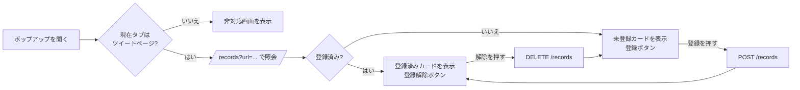
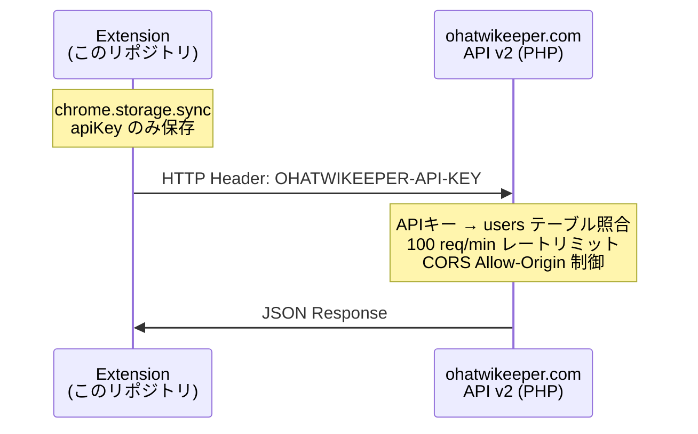

<div align="center">

<p align="center"><a href="README.md">English</a> | <b>日本語</b></p>

<h1 align="center">Ohatwikeeper Extension</h1>

<h3 align="center">X の「おはツイ」を、ワンクリックで記録。</h3>

<p align="center"><a href="https://ohatwikeeper.com">おはツイKeeper</a> のブラウザ拡張機能です。表示中のツイートを登録でき、連続投稿日数や統計も X を離れずにポップアップで確認できます。</p>

<p align="center">
  <a href="https://github.com/ohatwikeeper/ohatwikeeper-extension/tags"></a>
  <a href="LICENSE"></a>
  <a href="https://developer.chrome.com/docs/extensions/develop/migrate"></a>
  <a href="https://chromewebstore.google.com/detail/aflgkhadffoploabchfeaakdkaggchig"></a>
  <a href="https://addons.mozilla.org/ja/firefox/addon/%E3%81%8A%E3%81%AF%E3%83%84%E3%82%A4keeper_extension/"></a>
  <a href="https://github.com/ohatwikeeper/ohatwikeeper-extension/stargazers"></a>
  <a href="https://github.com/ohatwikeeper/ohatwikeeper-extension/commits/master"></a>
</p>

<p align="center">
  <a href="#クイックスタート">クイックスタート</a> ·
  <a href="#特長">特長</a> ·
  <a href="#セキュリティ">セキュリティ</a> ·
  <a href="#開発">開発</a>
</p>

<p align="center">
  <a href="https://ohatwikeeper.com">公式サイト</a> ·
  <a href="https://ohatwikeeper.com/dashboard">ダッシュボード</a> ·
  <a href="https://ohatwikeeper.com/api-docs">API ドキュメント</a> ·
  <a href="https://ohatwikeeper.com/howtouse">使い方</a> ·
  <a href="https://discord.ohatwikeeper.com">Discord</a> ·
  <a href="https://twitter.ohatwikeeper.com">公式X</a> ·
  <a href="https://status.ohatwikeeper.com">稼働状況</a>
</p>

</div>

---

X でツイートを開き、ツールバーのアイコンから登録ボタンを押します。ポップアップでは、登録済みかどうか、連続投稿日数、総投稿数、総いいね数も確認できるので、ダッシュボードを別タブで開く必要はありません。

## 特長

- 表示中のツイートをワンクリックで登録できます。
- 登録済み・未登録を自動で判定し、登録解除もポップアップから行えます。
- 連続投稿日数、総投稿数、総いいね数と、X のアイコン・ユーザー名を表示します。
- 連続日数をツールバーアイコンのバッジに表示します。
- API v2 ベースの軽量な実装で、依存ライブラリもバンドラーも不要です。

やらないこと:

- パスワードや X の認証情報を扱いません。
- バックグラウンドでの常時トラッキングや、サードパーティへのデータ送信をしません。
- `ohatwikeeper.com` 以外には通信しません。
- 要求する権限は `storage` と `activeTab` だけです。

## クイックスタート

公式ストアからのインストールを推奨します。

| ブラウザ | 入手先 |
|---|---|
| Chrome / Edge / Brave など | [Chrome ウェブストア](https://chromewebstore.google.com/detail/aflgkhadffoploabchfeaakdkaggchig?utm_source=item-share-cb) |
| Firefox | [Firefox Add-ons](https://addons.mozilla.org/ja/firefox/addon/%E3%81%8A%E3%81%AF%E3%83%84%E3%82%A4keeper_extension/) |

ダウンロードページとインストール方法: https://ohatwikeeper.com/extension

インストール後、ツールバーのアイコンから設定ページを開き、[ダッシュボード](https://ohatwikeeper.com/dashboard)で発行した **APIキー** を貼り付けて保存してください。

<details>
<summary>ソースから手動でインストール（開発者向け・未パッケージ版）</summary>

1. このリポジトリをダウンロードまたは clone します。
2. Chrome で `chrome://extensions` を開きます。
3. 右上の **デベロッパーモード** を ON にします。
4. **パッケージ化されていない拡張機能を読み込む** をクリックし、`manifest.json` があるこのフォルダを選びます。
5. ツールバーのアイコンから設定ページを開き、APIキーを貼り付けて保存します。

</details>

## UI

拡張機能全体はダークテーマで統一し、配色はサイト本体に合わせています（ブルーのアクセント `#38bdf8` とゴールド `#f59e0b`）。

**ポップアップ**（メイン操作画面・360px固定幅）

- ヘッダー: ロゴと、連携中の X アイコン・ユーザー名
- 統計バー: 連続日数、総投稿数、総いいね、今日の状況（4カラム）
- ツイートカード: URL、本文プレビュー、日時、投稿者と、登録済み / 未登録のバッジ
- アクションボタン: 登録または登録解除
- ナビバー: ダッシュボード、ランキング、今日、設定への直行リンク

**設定ページ**（サイドバー型のフルページ）

- 4つのタブ: APIキー設定、統計、クイックリンク、About
- APIキー設定: パスワード形式の入力欄、表示切替、保存と検証のボタン
- 3ステップの案内: ダッシュボード、APIセクション、貼り付け

### ポップアップの動作フロー



<details>
<summary>デザイントークン</summary>

`popup.html` と `options.html` に、CSS変数として直接定義しています。

| トークン | 値 | 用途 |
|---|---|---|
| `--accent` | `#38bdf8` | プライマリボタン、リンク、未登録の状態 |
| `--success` | `#22c55e` | 登録済みバッジ、成功メッセージ |
| `--gold` | `#f59e0b` | いいね数、ハイライト統計 |
| `--danger` | `#ef4444` | 登録解除、エラーメッセージ |
| `--bg` / `--bg-med` / `--bg-light` | `#101418` / `#1a2026` / `#2c343c` | 背景3階層（カード分離用） |
| `--text` / `--muted` | `#e2e8f0` / `#94a3b8` | 本文 / 補足テキスト |

</details>

## セキュリティ

拡張機能はAPIキーを運ぶだけです。認可の処理はすべてサーバー側（`api/v2/index.php`）にあり、このリポジトリには含まれません。



| 観点 | 内容 |
|---|---|
| 認証情報 | `chrome.storage.sync` に保存するのはAPIキーだけです。X のパスワードなどは扱いません。 |
| 通信先 | `https://ohatwikeeper.com` 固定です。`host_permissions` でも他ドメインにはアクセスできません。 |
| 権限 | `storage` と `activeTab` の2つだけです。`tabs` 権限は要求しません。 |
| レート制限 | サーバー側で、APIキーごとに1分あたり100リクエストまでです。 |
| ハードコードされた秘密情報 | ありません。キーは実行時にユーザーが入力し、storage から読み出します。 |

> [!NOTE]
> レート制限とサーバー側の検査は、以前の README の記述に基づきます。サーバー側の挙動なので、ここではサーバーのコードと照合していません。

## 開発

ファイル構成:

```
.
├── manifest.json      # Manifest V3 定義（権限・エントリポイント）
├── constants.js       # API_BASE / SITE 定数（全スクリプト共通）
├── background.js      # Service Worker（バッジ更新）
├── popup.html / .js   # メインUI（ツイート登録・統計表示）
├── options.html / .js # 設定ページ（APIキー管理・クイックリンク）
└── images/            # icon16.png, icon48.png, icon128.png
```

<details>
<summary>各ファイルの役割</summary>

| ファイル | 役割 |
|---|---|
| `manifest.json` | MV3 設定。`permissions: ["storage", "activeTab"]` と `host_permissions: ["https://ohatwikeeper.com/*"]` だけの最小権限構成です。 |
| `constants.js` | `API_BASE = 'https://ohatwikeeper.com/api/v2/user'` を一元管理します。エンドポイントを変えるときはここだけ直します。 |
| `background.js` | `chrome.storage.sync` の `apiKey` を使って `/stats` と `/me` を取得し、アイコンバッジに連続日数を表示します。 |
| `popup.js` | 現在のタブがツイートか判定し、`/records?url=...` で登録状況を取得して、登録と解除のUIを切り替えます。 |
| `options.js` | APIキーの保存と検証（`/me` への疎通確認）、プロフィールカードの表示、クイックリンクの一覧を担当します。 |

</details>

- 依存ライブラリはなく、Vanilla JS とインラインCSSだけです。ファイルを直接編集して、拡張機能をリロードするだけで確認できます。
- API エンドポイントの一覧は [API ドキュメント](https://ohatwikeeper.com/api-docs) を参照してください。
- バージョンを上げるときは、`manifest.json` の `"version"` をリリースに合わせます。

<details>
<summary>File information（配布用 zip）</summary>

配布用 zip（`ohatwikeeper_v2.0.zip`）のハッシュ値です。ダウンロード後の改竄や破損のチェックに使ってください。

```
ohatwikeeper_v2.0.zip

Size   : 14713 bytes
SHA256 : 6a296acccd1b86eca07ae6794b55ecda62e4867135b8d1b51cf02b533b28f8cd
```

Linux / macOS:

```sh
sha256sum ohatwikeeper_v2.0.zip
```

Windows (PowerShell):

```powershell
Get-FileHash .\ohatwikeeper_v2.0.zip -Algorithm SHA256
```

出力が上の SHA256 と一致すれば、ファイルは改竄されていません。zip はこのリポジトリにないため、これらの値はここでは再確認していません。

</details>

## ライセンス

オープンソースではありません。公式の配布物は無償で使えますが、ソースの改変や再配布はできません。詳細は [LICENSE](./LICENSE) を参照してください。
