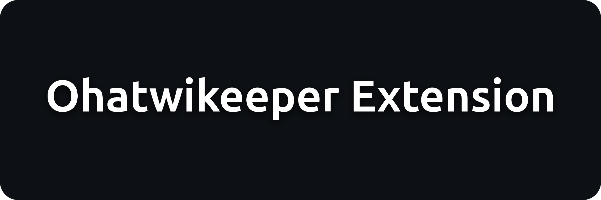
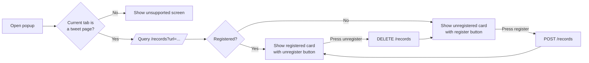
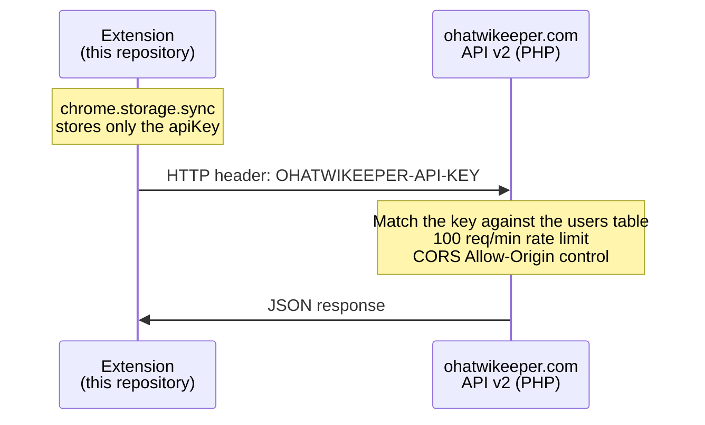

<div align="center">

<p align="center">
  
</p>

<p align="center"><b>English</b> | <a href="README.ja.md">日本語</a></p>

<h1 align="center">Ohatwikeeper Extension</h1>

<h3 align="center">Record your good-morning tweets on X with one click.</h3>

<p align="center">A browser extension for <a href="https://ohatwikeeper.com">おはツイKeeper</a>. Register the tweet you are viewing, and check your streak and stats in a popup without leaving X.</p>

<p align="center">
  <a href="https://github.com/ohatwikeeper/ohatwikeeper-extension/tags"></a>
  <a href="LICENSE"></a>
  <a href="https://developer.chrome.com/docs/extensions/develop/migrate"></a>
  <a href="https://chromewebstore.google.com/detail/aflgkhadffoploabchfeaakdkaggchig"></a>
  <a href="https://addons.mozilla.org/ja/firefox/addon/%E3%81%8A%E3%81%AF%E3%83%84%E3%82%A4keeper_extension/"></a>
  <a href="https://github.com/ohatwikeeper/ohatwikeeper-extension/stargazers"></a>
  <a href="https://github.com/ohatwikeeper/ohatwikeeper-extension/commits/master"></a>
</p>

<p align="center">
  <a href="#quick-start">Quick start</a> ·
  <a href="#features">Features</a> ·
  <a href="#security">Security</a> ·
  <a href="#development">Development</a>
</p>

<p align="center">
  <a href="https://ohatwikeeper.com">Website</a> ·
  <a href="https://ohatwikeeper.com/dashboard">Dashboard</a> ·
  <a href="https://ohatwikeeper.com/api-docs">API docs</a> ·
  <a href="https://ohatwikeeper.com/howtouse">How to use</a> ·
  <a href="https://discord.ohatwikeeper.com">Discord</a> ·
  <a href="https://twitter.ohatwikeeper.com">X</a> ·
  <a href="https://status.ohatwikeeper.com">Status</a>
</p>

</div>

---

Open a tweet on X, click the toolbar icon, and press the register button. The popup also shows whether the tweet is already registered, your streak, total posts, and total likes, so you do not need a separate dashboard tab.

## Features

- Register the displayed tweet with one click.
- Detect registered and unregistered tweets automatically; unregister from the popup.
- Show streak, total posts, and total likes, plus your X avatar and user name.
- Show the streak on the toolbar icon badge.
- Lightweight: API v2, vanilla JS, no dependencies, no bundler.

What it does not do:

- It does not handle your X password or credentials.
- It does not track in the background or send data to third parties.
- It does not connect to anything other than `ohatwikeeper.com`.
- It asks only for `storage` and `activeTab`.

## Quick start

Install from the official store (recommended):

| Browser | Get it |
|---|---|
| Chrome / Edge / Brave and others | [Chrome Web Store](https://chromewebstore.google.com/detail/aflgkhadffoploabchfeaakdkaggchig?utm_source=item-share-cb) |
| Firefox | [Firefox Add-ons](https://addons.mozilla.org/ja/firefox/addon/%E3%81%8A%E3%81%AF%E3%83%84%E3%82%A4keeper_extension/) |

Download page and install guide: https://ohatwikeeper.com/extension

After installing, click the toolbar icon, open the settings page, paste the **API key** issued on the [dashboard](https://ohatwikeeper.com/dashboard), and save.

<details>
<summary>Install from source (developers, unpacked)</summary>

1. Download or clone this repository.
2. Open `chrome://extensions` in Chrome.
3. Turn on **Developer mode** (top right).
4. Click **Load unpacked** and select this folder (it contains `manifest.json`).
5. Open the settings page from the toolbar icon and paste your API key.

</details>

## UI

The extension uses one dark theme that follows the site: blue accent `#38bdf8` and gold `#f59e0b`.

**Popup** (main screen, fixed 360px width)

- Header: logo and the linked X avatar and user name.
- Stats bar: streak, total posts, total likes, and today's status (4 columns).
- Tweet card: URL, text preview, date, author, and a registered / unregistered badge.
- Action button: register or unregister.
- Nav bar: direct links to the dashboard, ranking, today, and settings.

**Settings page** (full page with a sidebar)

- Four tabs: API key, stats, quick links, and About.
- API key: password-style field, show/hide toggle, save and verify buttons.
- A three-step guide: dashboard, API section, paste.

### Popup flow



<details>
<summary>Design tokens</summary>

CSS variables defined directly in `popup.html` and `options.html`.

| Token | Value | Use |
|---|---|---|
| `--accent` | `#38bdf8` | Primary buttons, links, unregistered state |
| `--success` | `#22c55e` | Registered badge, success messages |
| `--gold` | `#f59e0b` | Like counts, highlighted stats |
| `--danger` | `#ef4444` | Unregister, error messages |
| `--bg` / `--bg-med` / `--bg-light` | `#101418` / `#1a2026` / `#2c343c` | Three background levels |
| `--text` / `--muted` | `#e2e8f0` / `#94a3b8` | Body / secondary text |

</details>

## Security

The extension only carries the API key. All authorization logic lives on the server (`api/v2/index.php`), which is not in this repository.



| Item | Detail |
|---|---|
| Credentials | Only the API key is stored in `chrome.storage.sync`. X passwords are never handled. |
| Destination | Fixed to `https://ohatwikeeper.com`; `host_permissions` allows no other domain. |
| Permissions | `storage` and `activeTab` only. No `tabs` permission. |
| Rate limit | Up to 100 requests per minute per API key, enforced on the server. |
| Hardcoded secrets | None. The key is entered by the user and read from storage at run time. |

> [!NOTE]
> The rate limit and server-side checks are described from the previous README. They are server behavior and were not verified against server code here.

## Development

Files:

```
.
├── manifest.json      # Manifest V3 (permissions, entry points)
├── constants.js       # API_BASE / SITE constants shared by all scripts
├── background.js      # Service worker (badge update)
├── popup.html / .js   # Main UI (register tweets, show stats)
├── options.html / .js # Settings page (API key, quick links)
└── images/            # icon16.png, icon48.png, icon128.png
```

<details>
<summary>What each file does</summary>

| File | Role |
|---|---|
| `manifest.json` | MV3 settings. `permissions: ["storage", "activeTab"]` and `host_permissions: ["https://ohatwikeeper.com/*"]` only. |
| `constants.js` | Holds `API_BASE = 'https://ohatwikeeper.com/api/v2/user'`. Edit only here when the endpoint changes. |
| `background.js` | Reads the `apiKey` in `chrome.storage.sync`, fetches `/stats` and `/me`, and updates the icon badge with the current streak. |
| `popup.js` | Checks whether the current tab is a tweet, queries `/records?url=...`, and switches between register and unregister. |
| `options.js` | Saves and verifies the API key (a request to `/me`), shows the profile card, and lists quick links. |

</details>

- No dependencies: vanilla JS and inline CSS. Edit the files and reload the extension.
- For the endpoint list, see the [API docs](https://ohatwikeeper.com/api-docs).
- When you bump the version, keep `"version"` in `manifest.json` in step with the release.

<details>
<summary>File information (distribution zip)</summary>

Hash of the distribution zip `ohatwikeeper_v2.0.zip`, for checking for tampering or corruption after download.

```
ohatwikeeper_v2.0.zip

Size   : 14713 bytes
SHA256 : 6a296acccd1b86eca07ae6794b55ecda62e4867135b8d1b51cf02b533b28f8cd
```

Linux / macOS:

```sh
sha256sum ohatwikeeper_v2.0.zip
```

Windows (PowerShell):

```powershell
Get-FileHash .\ohatwikeeper_v2.0.zip -Algorithm SHA256
```

If the output matches the SHA256 above, the file is unchanged. The zip is not in this repository, so these values were not re-checked here.

</details>

## License

Not open source. The official builds are free to use, but you may not modify or redistribute the source. See [LICENSE](./LICENSE).
